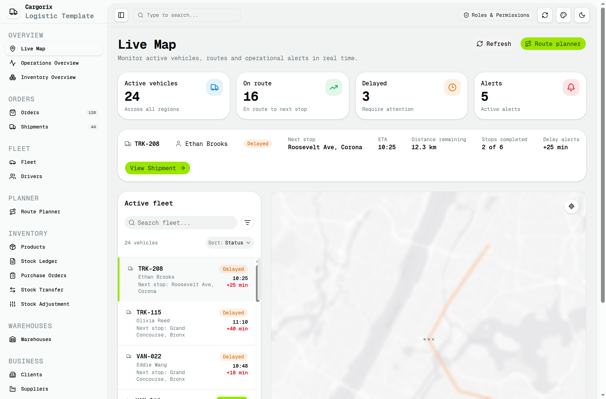
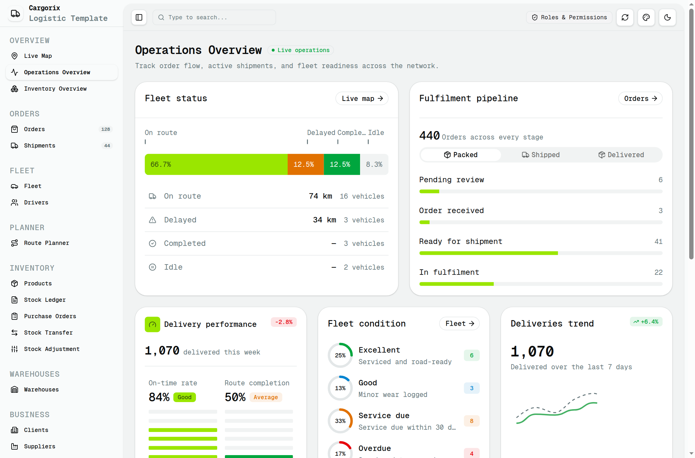
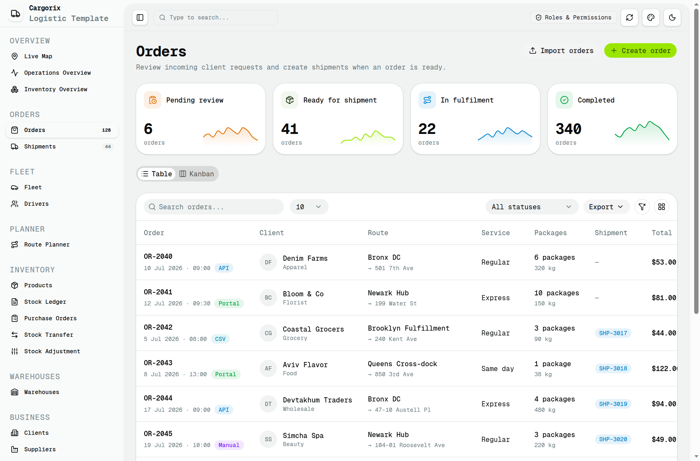
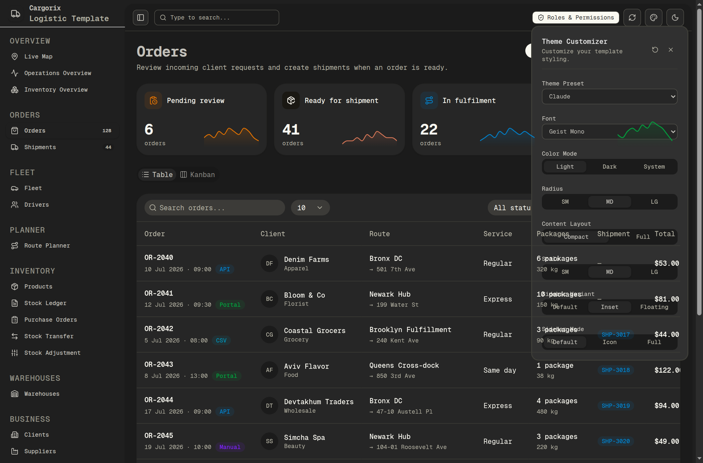
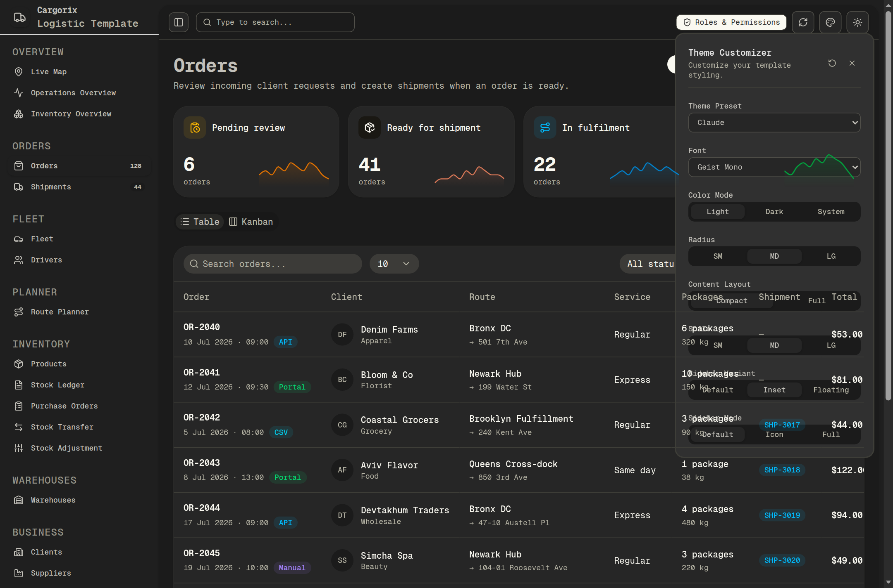

# Cargorix: Shadcn Next.js Logistic App Template

Clone dan rewrite berfidelitas tinggi (*100% pixel-perfect Next.js App Router rewrite*) dari template logistik enterprise **Cargorix** (`https://shadcn-nextjs-cargorix-app-template.vercel.app/`).

Dibangun dengan arsitektur **Next.js 16 (App Router + Turbopack)**, **React 19**, **Tailwind CSS**, token desain **Shadcn UI** (aksen *lime green* `#9de500`), serta fitur **Theme Customizer** (12 preset warna OKLCH, radius, font, skala, dan mode sidebar) yang persis dengan versi aslinya.

---

## 1. Pratinjau Tampilan Antarmuka

### Live Map Dashboard (`/live-map`)


### Operations Overview (`/operations-overview`)


### Orders Management (`/orders`)


### Theme Customizer Popover (12 Presets & Multi-font)


### Dark Mode Cockpit


---

## 2. Cakupan Seluruh Rute & Sub-Menu (24 Routes)

Seluruh 24 rute dan sub-menu telah diimplementasikan sesuai URL target:

1. **Overview**:
   - `/live-map` dan `/live-map/[id]`: Radar pelacak armada interaktif New York City (Bronx ➔ Harlem ➔ Corona Queens), rincian kendaraan tertunda (TRK-208), dan kontrol rute.
   - `/operations-overview`: Dashboard operasi global dengan visualisasi segmented bar armada, pemenuhan order, performa pengiriman mingguan, kelayakan armada, dan tren pengiriman.
   - `/inventory-overview`: Ringkasan metrik inventaris pergudangan, stok kritis, dan status SKU.

2. **Orders**:
   - `/orders`: Tabel komprehensif data order (`OR-2040` dst.), multi-badge status, tag asal input (API, Portal, CSV, Manual), rute, dan tautan pengiriman langsung.
   - `/shipments` dan `/shipments/[id]`: Pelacakan manifes pengiriman logistik, dokumen jalan, dan status kurir.

3. **Fleet & Personnel**:
   - `/fleet`: Katalog lengkap armada kendaraan (Truk kontainer, Van ekspres, Sepeda kurir kota).
   - `/drivers`: Profil staf pengemudi, riwayat lisensi, rating keamanan berkendara, dan penugasan armada aktif.

4. **Planning & Warehouse Inventory**:
   - `/route-planner`: Optimasi rute pengiriman multi-titik dan estimasi waktu tempuh (ETA).
   - `/products`: Manajemen katalog produk master dan spesifikasi berat/dimensi kargo.
   - `/stock-ledger`: Buku besar pergerakan mutasi stok barang masuk dan keluar.
   - `/purchase-orders`: Pengadaan barang dan pesanan pembelian ke pemasok.
   - `/stock-transfers`: Transfer antar gudang dan monitoring kargo transit.
   - `/stock-adjustments`: Penyesuaian stok selisih opname fisik pergudangan.
   - `/warehouses`: Daftar hub distribusi logistik, kapasitas volume kubik, dan utilisasi rak.

5. **Business & Governance**:
   - `/clients`: Direktori mitra klien korporat B2B.
   - `/suppliers`: Direktori vendor dan mitra rantai pasok.
   - `/reports`: Laporan analitik keuangan kargo dan utilisasi armada.

6. **Settings**:
   - `/settings/general`: Pengaturan umum organisasi dan zona waktu.
   - `/settings/team`: Hak akses pengguna (*Team & RBAC*).
   - `/settings/notifications`: Konfigurasi peringatan keterlambatan dan webhook.
   - `/settings/activity`: Audit log riwayat aktivitas operasional sistem.

---

## 3. Fitur Unggulan Theme Customizer

Tombol **Customize Theme** di header menyediakan penyesuaian gaya secara langsung (*live state persistence* via `localStorage`):

* **12 Theme Presets**: Default, Caffeine, Claude, Corporate, Ghibli Studio, Marvel, Material Design, Modern Minimal, Nature, Perplexity, Slack, Pastel Dreams (menginjeksi variabel warna OKLCH asli).
* **Typography Selector**: Geist Mono, Inter, IBM Plex Sans, Roboto, JetBrains Mono.
* **Color Mode**: Light, Dark, System.
* **Radius Customizer**: SM (`0.45rem`), MD (`0.625rem`), LG (`0.85rem`).
* **Content Layout**: Compact (`max-w-360 mx-auto`) vs Full Width (`w-full`).
* **Scale**: SM, MD, LG (`data-theme-scale`).
* **Sidebar Variant**: Inset, Default, Floating.
* **Sidebar Mode**: Expanded (Default), Collapsed (Icon), Full.

---

## 4. Panduan Menjalankan Projek

```bash
# 1. Masuk ke direktori
cd /root/cargorix-template

# 2. Pasang dependensi
bun install
# atau: npm install

# 3. Jalankan server pengembangan
bun run dev
# atau: npm run dev

# 4. Bangun versi produksi
bun run build
bun run start
```

Aplikasi dapat diakses pada browser di: `http://localhost:3000` (atau port yang ditentukan).

---

## 5. Struktur Berkas Projek

```
cargorix-template/
├── src/
│   ├── app/
│   │   ├── layout.tsx                 # Root layout dengan Font, Sidebar, & SiteHeader
│   │   ├── globals.css                # Tailwind CSS v4 & Shadcn design tokens
│   │   ├── page.tsx                   # Redirect ke /live-map
│   │   ├── live-map/                  # /live-map & /live-map/[id]
│   │   ├── operations-overview/       # /operations-overview
│   │   ├── inventory-overview/        # /inventory-overview
│   │   ├── orders/                    # /orders
│   │   ├── shipments/                 # /shipments & /shipments/[id]
│   │   ├── fleet/                     # /fleet
│   │   ├── drivers/                   # /drivers
│   │   ├── route-planner/             # /route-planner
│   │   ├── products/                  # /products
│   │   ├── stock-ledger/              # /stock-ledger
│   │   ├── purchase-orders/           # /purchase-orders
│   │   ├── stock-transfers/           # /stock-transfers
│   │   ├── stock-adjustments/         # /stock-adjustments
│   │   ├── warehouses/                # /warehouses
│   │   ├── clients/                   # /clients
│   │   ├── suppliers/                 # /suppliers
│   │   ├── reports/                   # /reports
│   │   └── settings/                  # /settings/general, team, notifications, activity
│   ├── components/
│   │   ├── AppSidebar.tsx             # Sidebar navigasi dinamis dengan next/link
│   │   ├── SiteHeader.tsx             # Header sticky dengan pencarian & toggle tema
│   │   ├── SidebarWrapper.tsx         # Responsive sidebar & main inset controller
│   │   ├── ThemeCustomizer.tsx        # 12 presets theme dialog popover
│   │   └── InteractiveMap.tsx         # Leaflet transit routing map
│   └── lib/
│       └── leaflet-helper.ts          # Helper inisialisasi peta geospatial
├── public/
│   └── assets/css/fonts.css           # Webfont fallback definitions
├── screenshots/                       # Bukti verifikasi visual UI
├── package.json
├── tsconfig.json
└── README.md
```
