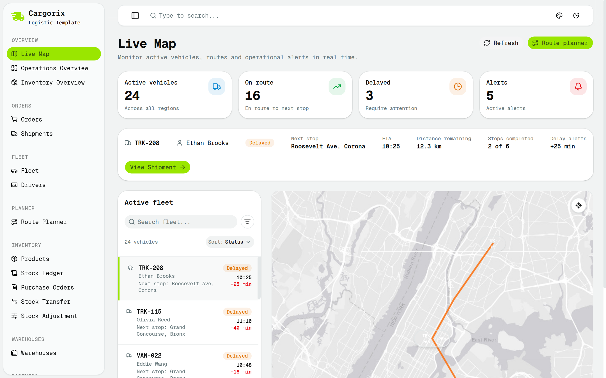
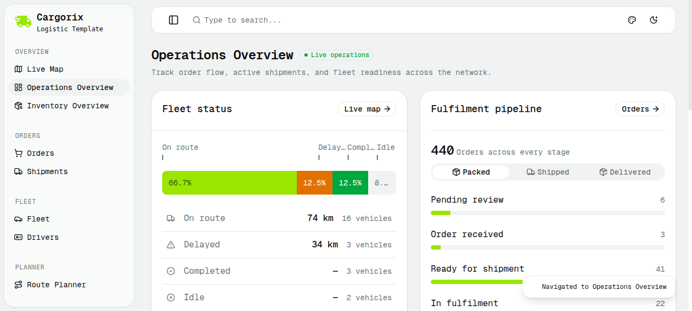
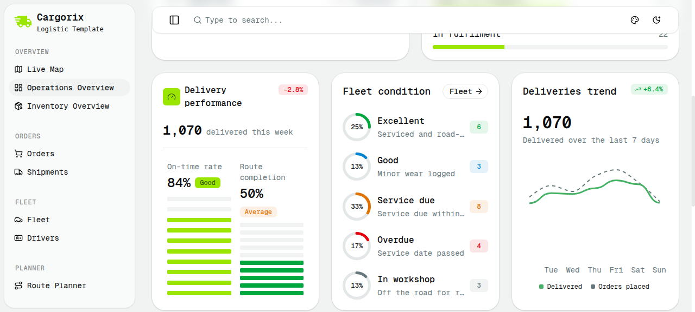
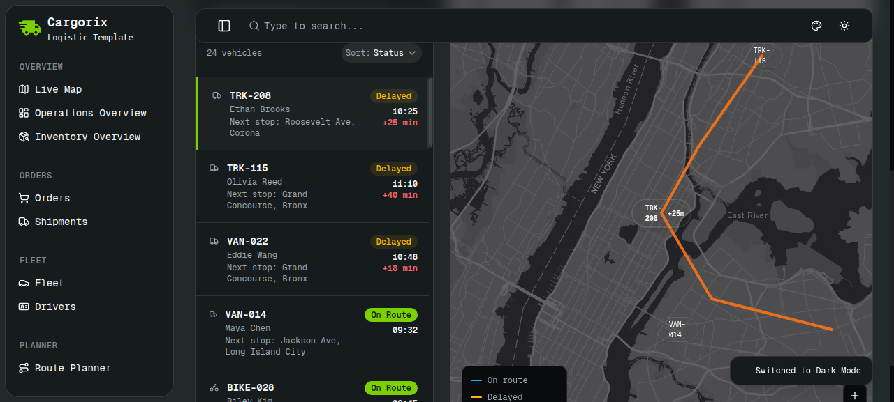

# Cargorix - Logistic Template (1-Page HTML Clone)

Clone beresolusi tinggi (*high-fidelity single-page HTML*) dari template logistik modern **Cargorix** (`https://shadcn-nextjs-cargorix-app-template.vercel.app/`), dibangun dengan arsitektur Tailwind CSS, token desain Shadcn UI (aksen *lime green* `#9de500` / `#80cd00`), serta peta interaktif berbasis Leaflet.

---

## 1. Pratinjau Tampilan

### Live Map Dashboard (Default View)


### Operations Overview Dashboard (Navigasi Sidebar Interaktif)



### Dark Mode


---

## 2. Fitur Utama yang Telah Di-clone

1. **Sidebar Navigasi Bertingkat (Collapsible & Responsive)**:
   - Identitas brand Cargorix dengan logo truk kurir.
   - Kategori menu lengkap:
     - **Overview**: *Live Map* (Default aktif), *Operations Overview*, *Inventory Overview*.
     - **Orders**: *Orders*, *Shipments*.
     - **Fleet**: *Fleet*, *Drivers*.
     - **Planner**: *Route Planner*.
     - **Inventory**: *Products*, *Stock Ledger*, *Purchase Orders*, *Stock Transfer*, *Stock Adjustment*.
     - **Warehouses**: *Warehouses*.
   - Tombol toggle collapse/expand sidebar yang responsif.

2. **Top Header Bar**:
   - Kolom pencarian global (`Type to search...`).
   - Tombol switcher tema **Dark Mode / Light Mode** (mengubah warna kartu, sidebar, dan tile peta secara instan).
   - Indikator notifikasi dan status pengguna.

3. **Tampilan 1: Live Map Dashboard (`/live-map/TRK-208`)**:
   - **4 Kartu Metrik Kunci**: Active vehicles (`24`), On route (`16`), Delayed (`3`), Alerts (`5`).
   - **Banner Kendaraan Aktif**: TRK-208 (Driver Ethan Brooks, status *Delayed +25 min*, next stop Roosevelt Ave, ETA 10:25, tombol *View Shipment*).
   - **Active Fleet Directory**: Daftar kendaraan dengan status On Route / Delayed, waktu kedatangan, dan filter pencarian.
   - **Peta Interaktif (Leaflet + Esri Gray Canvas Tiles)**:
     - Rute lintasan transit New York City (Bronx ➔ Harlem ➔ Corona Queens) berwarna oranye tebal.
     - Marker dinamis beranimasi pulsing untuk TRK-208 (+25m delay pill) serta marker armada lainnya (TRK-115, VAN-014, BIKE-028).
     - Tombol *Recenter Map* dan *Zoom Controls*.

4. **Tampilan 2: Operations Overview Dashboard (`/operations-overview`)**:
   - Dapat diakses 1-klik via menu sidebar tanpa reload halaman.
   - **Fleet Status**: Segmented bar (On route 66.7%, Delayed 12.5%, Completed 12.5%, Idle 8.3%) dan rincian jarak tempuh armada.
   - **Fulfilment Pipeline**: 440 order di berbagai tahap dengan filter tab (*Packed, Shipped, Delivered*) dan bar progres.
   - **Delivery Performance**: Statistik 1.070 pengiriman minggu ini, on-time rate 84%, dan route completion 50%.
   - **Fleet Condition**: Persentase kelayakan kendaraan (25% Excellent, 13% Good, 33% Service due, 17% Overdue, 13% Workshop).
   - **Deliveries Trend**: Grafik kurva tren 7 hari membandingkan *Delivered* vs *Orders placed*.

---

## 3. Cara Menjalankan

Projek ini berupa file HTML mandiri (`index.html`). Anda dapat menjalankannya dengan local web server bawaan Python:

```bash
cd /root/cargorix-template
python3 -m http.server 8089
```

Buka di browser pada: `http://localhost:8089` (atau via IP VPS: `http://<IP-VPS>:8089`).

---

## 4. Struktur Berkas

```
cargorix-template/
├── index.html                  # File HTML 1 page utama (Live Map + Ops Overview + Dark Mode)
├── assets/
│   └── css/
│       ├── main.css            # Tailwind CSS & Shadcn design tokens
│       └── fonts.css           # Definisi font Geist, Inter, dan IBM Plex Sans
├── screenshots/
│   ├── live-map.png
│   ├── operations-overview-top.png
│   ├── operations-overview-bottom.png
│   └── dark-mode.png
├── build_index.py              # Generator script perakit DOM & aset
├── README.md
└── .gitignore
```
